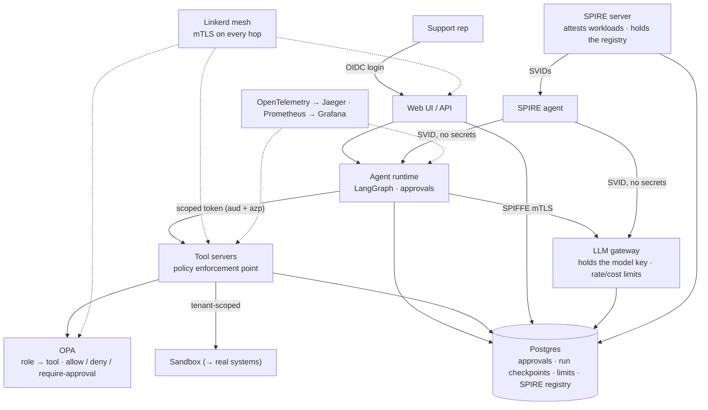

# Agent Identity Platform

**An identity and authorization layer for AI agents.** Agents here carry no API
keys and no passwords: they get a short-lived cryptographic identity (SPIFFE),
act for a specific person through OAuth 2.0 token exchange, and every action is
checked by policy (OPA) — with human approval for high-risk ones and an audit
trail keyed to the identity, not the model.

It is a runnable, production-shaped reference, not a slide deck: a
**customer-support & refunds copilot** on a 3-node Kubernetes cluster (kind),
with a real UI, durable state, mTLS, HA, autoscaling and per-tenant policy.

> **Status:** complete and runnable. Every threat in the
> [threat model](docs/threat-model.md) is addressed and each has a test that
> proves it. See [`HANDOFF.md`](HANDOFF.md) and [`docs/roadmap.md`](docs/roadmap.md).

## What you get

A demo you can drive in a browser, backed by real code:

- Sign in as a support rep; the agent acts **for that person**, under a scoped,
  short-lived token — never on a shared key.
- *"Issue a refund of 200 dollars for order o-1001"* pauses for **manager
  approval**; approve it and it is issued. A $1000 refund is refused; a
  read-only user is refused; `globex`'s support rep is refused the same refund
  that `acme`'s may issue.
- The **Roles** tab shows your tenant's role → tool matrix, read from policy;
  **Audit** and **Privacy** show every decision with the policy revision that
  made it.

## Run it

**Prerequisites:** Docker Desktop (about 8 GB of memory), `git`, and
`kind`, `kubectl`, `python3`, `curl`, `openssl`. On macOS:

```sh
brew install kind kubectl python curl openssl   # plus Docker Desktop
```

```sh
git clone https://github.com/fkadusei/agent-identity-platform.git
cd agent-identity-platform
./scripts/doctor.sh     # checks the tools, Docker, the port, and the model
./start.sh              # builds on first run (~10-15 min); resumes quickly after
```

Open **https://localhost:8443** and sign in as `alice` / `alice123`.

> The certificate is generated by `setup.sh`, not a public CA, so the browser
> asks you to trust it once: import `.edge/ca.crt` (gitignored), or use the CLI
> with `--cacert .edge/ca.crt`. TLS terminates at an ingress; the API's own
> listener is never exposed to the host.

| user | password | role | can |
| --- | --- | --- | --- |
| `alice` | `alice123` | support_rep | everything but PII |
| `bella` | `bella123` | billing | orders + refunds only |
| `dana` | `dana1234` | read_only | reads only |
| `priya` | `priya123` | privacy | reads PII (with approval) + the basic reads |
| `manager` | `manager123` | manager | reads + refund quotes; approves |
| `admin` | `admin123` | platform_admin | administers users; no tools, no approvals |
| `grace` | `grace123` | support_rep (tenant `globex`) | the second tenant |

`./status.sh` says whether it is up; `./stop.sh` stops it.

## Choose a model

No model is required to run the demo: if Ollama is not present, the first run
uses an in-cluster **OpenAI-compatible test double** so the whole flow still
works. Change the choice at any time — no rebuild:

```sh
./scripts/use-model.sh                      # interactive: local / hosted / none
./scripts/use-model.sh --list               # the models your Ollama has
./scripts/use-model.sh --local llama3.2:3b  # a local model (stays on the machine)
./scripts/use-model.sh --hosted https://api.openai.com/v1 gpt-4o-mini
./scripts/use-model.sh --stub               # the test double, no model, no key
```

- **Local-first.** Ollama keeps the data on this machine; that is the default.
- **Any OpenAI-compatible endpoint** works (OpenAI, Groq, Together, vLLM, …) —
  the standard this project already speaks, not a bespoke integration.
- The provider key lives **only** in `.env` and the `llm-api-key` Secret the
  gateway mounts. The agent never holds a model credential and is the only
  consumer of the gateway. See [`docs/llm-gateway.md`](docs/llm-gateway.md) and
  ADR-0009 / ADR-0013.

## Standards, not bespoke protocols

Where a standard exists, it wins: **OIDC** for login, **OAuth 2.0 Token Exchange
(RFC 8693)** for delegation, **SPIFFE/SPIRE** for workload identity,
**OpenAI-compatible** chat completions for models, **OPA/Rego** for policy,
**OpenTelemetry** for traces, **Kubernetes** for deployment. The parts that are
custom are the policy and the wiring — not a new identity or token format.

## What to try

- The roles above: the same prompt as different users, and as `grace` in the
  second tenant.
- `./scripts/demo.sh` — read → `$200` refund → approval → issued.
- `./scripts/attack-tests.sh` — the attacks are blocked (no identity, replayed
  token, injection, approval bypass, PII leak, …).
- [`docs/site/index.html`](docs/site/index.html) — the live documentation
  (open it from disk, or `python3 -m http.server 8082 --directory docs/site`
  and pick any free port). It includes interactive 3D views of the trust flow
  and of one run in time.

## Architecture



## Security invariants

Held everywhere — code, config, tests, logs, traces, prompts:

1. No secret is ever committed (`.env` is local and gitignored; `.env.example`
   is the template).
2. No secret or token in logs, traces, or errors.
3. **Synthetic data only** — never real customer, card, or personal data.
4. **No card data, ever** — the payments path handles only opaque tokens.
5. Identity over secrets; least privilege; no token forwarding.
6. Human approval for high-risk actions, with no self-approval.
7. Roles gate tools, on the server; the tenant comes from the identity, never the
   request.

See [`SECURITY.md`](SECURITY.md), [`docs/threat-model.md`](docs/threat-model.md)
and [`docs/data-handling.md`](docs/data-handling.md).

## Verify it

```sh
.venv/bin/python -m pytest -q           # app: 283 passed, 23 skipped (Postgres)
sdk/.venv/bin/python -m pytest sdk -q   # SDK: 34
docker run --rm -v "$PWD":/w -w /w openpolicyagent/opa:1.9.0 test policy/   # 45

./scripts/demo.sh          # read → refund → approval → issued
./scripts/attack-tests.sh  # the attacks are blocked
./scripts/tenancy-tests.sh # tenant isolation, claim → policy → data
./scripts/role-tools.sh    # who may call which tool
./scripts/check-images.sh  # the pods run the code you built (git-stamped)
./scripts/tls-check.sh     # every in-cluster edge is mTLS
./scripts/ha-check.sh      # replicas spread; an eviction is survivable
./scripts/scan-secrets.sh  # no secrets in the tree or the full history
```

If the app tier ever crash-loops with `SPIFFE socket ... does not exist`, the
identity tier needs a reset: `./scripts/repair-spire.sh` (see the
[operator guide](docs/operator-guide.md)).

## Documentation

| Audience | Start here |
|---|---|
| Everyone | [`docs/site/index.html`](docs/site/index.html) — the living docs, plain language · [`docs/overview.html`](docs/overview.html) · [`docs/real-world-adoption.md`](docs/real-world-adoption.md) · [`docs/glossary.md`](docs/glossary.md) |
| Developers | [`CONTRIBUTING.md`](CONTRIBUTING.md) · [`docs/decisions/`](docs/decisions/) · [`docs/site/agent-flow.html`](docs/site/agent-flow.html) |
| Security | [`SECURITY.md`](SECURITY.md) · [`docs/threat-model.md`](docs/threat-model.md) · [`docs/roles-and-tools.md`](docs/roles-and-tools.md) · [`docs/privacy.md`](docs/privacy.md) |
| Models | [`docs/llm-gateway.md`](docs/llm-gateway.md) · [`scripts/use-model.sh`](scripts/use-model.sh) |
| Operators | [`docs/operator-guide.md`](docs/operator-guide.md) · [`docs/ha.md`](docs/ha.md) · [`docs/autoscaling.md`](docs/autoscaling.md) |
| Platform engineers | [`docs/ci-cd.md`](docs/ci-cd.md) · [`deploy/helm/agent-platform/`](deploy/helm/agent-platform/) |
| Resuming work | [`HANDOFF.md`](HANDOFF.md) · [`docs/roadmap.md`](docs/roadmap.md) · [`docs/backlog.md`](docs/backlog.md) |

## Repository layout

```
sdk/agentnhi/       reusable identity / delegation / policy / audit plumbing
app/agent           LangGraph agent with approval interrupts
app/api             FastAPI: login, enrollment, user admin, tasks, approvals, audit
app/web             React UI: console, approvals, roles, audit, admin
app/tools           policy enforcement point (HTTP + MCP transports)
app/gateway         the only egress to a model; SPIFFE mTLS; rate/cost limits
app/provider_stub   an in-cluster OpenAI-compatible test double (no key)
app/sandbox         synthetic systems exposed over HTTP (the tools' backend)
app/simulators      the simulated systems the tools act on (synthetic data)
policy/             OPA: role → tool, allow / deny / require-approval + tests
deploy/kind/        local kind manifests
deploy/helm/        cloud-agnostic Helm chart
docs/               design, security, decisions, adoption, guides, living pages
scripts/            setup, doctor, model chooser, demo, and the verification suites
```

## Contributing

Issues and pull requests are welcome — see [`CONTRIBUTING.md`](CONTRIBUTING.md).
Security problems: **do not** open a public issue; use GitHub's *Report a
vulnerability* ([`SECURITY.md`](SECURITY.md)).

## License

MIT — see [`LICENSE`](LICENSE).
